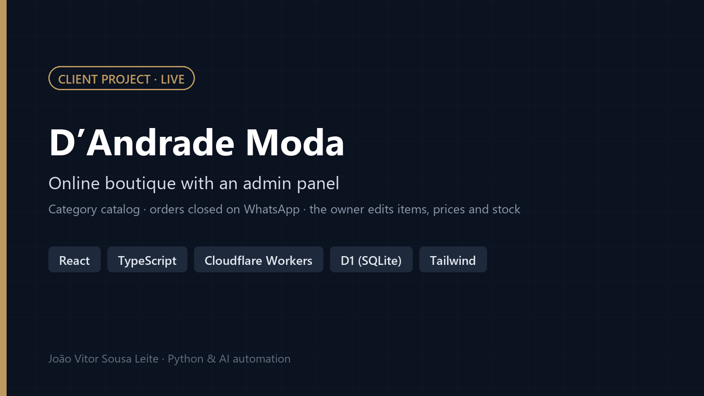
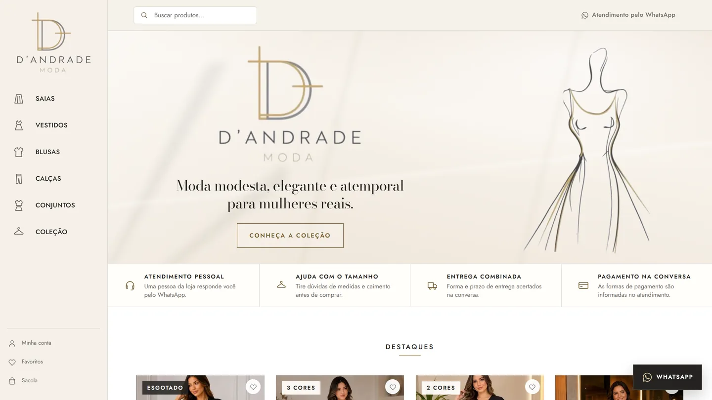
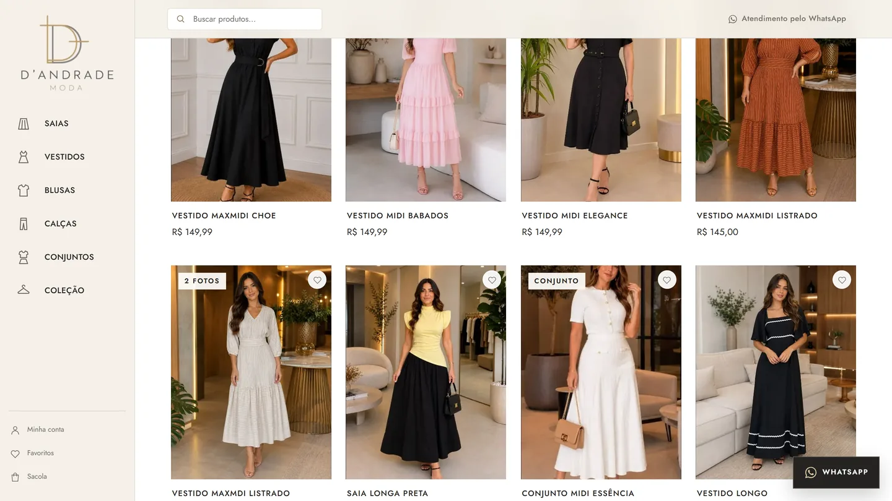
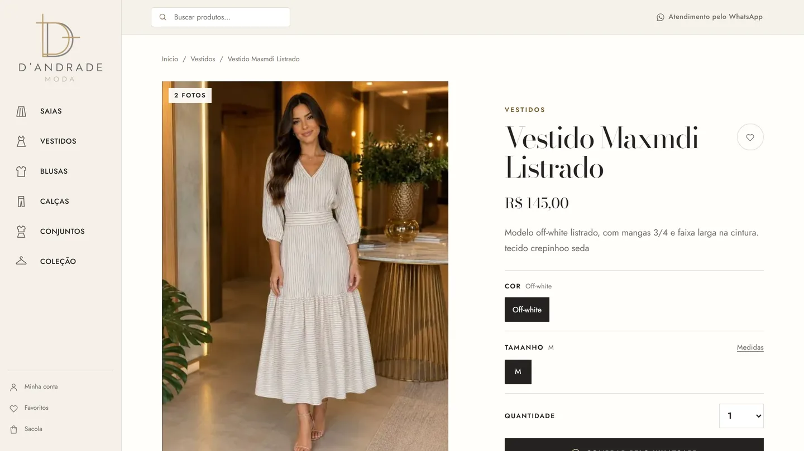
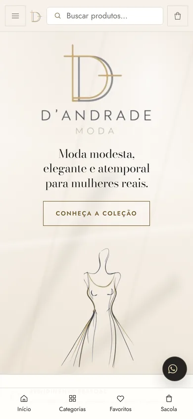
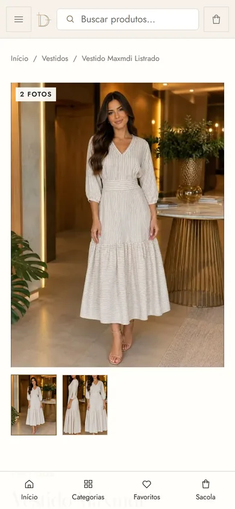

# D'Andrade Moda: online boutique with an admin panel

> **Case study only.** This is a real client project, live at **[dandrademoda.com.br](https://dandrademoda.com.br)** and shown with the owner's permission. The source code is private because it runs a live store, so this repository holds only the write-up and screenshots.

[Versão em português](#versão-em-português) · React 19 · TypeScript · Cloudflare Workers · D1 (SQLite) · Drizzle · Tailwind

## Problem

A small Brazilian boutique of modest women's fashion needed its own online catalog, on its own domain, that the owner could keep up to date herself, without a developer for every new item or price change.

## Solution

- **Storefront.** Catalog by category (skirts, dresses, blouses, pants, sets) with colors, sizes and quantities, search, favorites and a "new arrivals" page. The bag is saved in the browser.
- **Orders on WhatsApp.** At checkout the bag becomes a complete order summary (items, color, size, quantity, prices) sent to the store on WhatsApp, which is how the owner already closes sales.
- **Admin panel.** A private panel where the owner adds items and photos and updates prices and stock. Every admin screen and every admin API route checks the session on the server, and the panel stays out of the public menu, the sitemap and search.
- **Store pages.** About, how to buy, delivery, payment methods, returns, privacy and terms.
- **Handover.** I moved the database, the site and the domain from my Cloudflare account to the client's own account, and checked every table after the copy.

## Stack

- React 19 + TypeScript (vinext, a Vite-based Next.js-style framework), Tailwind CSS
- Cloudflare Workers for hosting and the API, with a custom domain
- Cloudflare D1 (SQLite) with Drizzle ORM for the catalog, stock and admin sessions
- AI-assisted development, with my architecture, direction and review

## Screenshots

| Home | Featured items |
|---|---|
|  |  |

| Product page | Phone |
|---|---|
|  |   |

Brand, product photos and catalog content belong to the client.

## Versão em português

Loja virtual de moda feminina, no ar em [dandrademoda.com.br](https://dandrademoda.com.br) e mostrada com autorização da dona. A compradora navega por categoria, escolhe cor, tamanho e quantidade, e a sacola vira um pedido completo enviado pelo WhatsApp. A dona cadastra peças, fotos, preços e estoque num painel com login verificado no servidor. React e TypeScript em Cloudflare Workers, banco D1. Fiz o desenvolvimento, a publicação e a entrega na conta Cloudflare da cliente. O código é privado porque roda uma loja no ar.

---

Built by [João Vitor Sousa Leite](https://joao-jleite.github.io/) · Python automation, AI integration and web apps.
